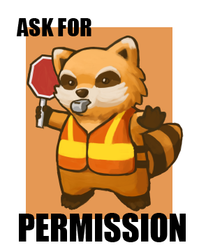

# CD: Scrappy

A robot dog for **Companion Dogs** (Project Zomboid, Build 42).

Scrappy is a scrap dog: it pulls the items another mod registers off the zombies that die near it,
carries a built-in cargo compartment (a metal case shows on its back when it holds something), gives
+20% Electrical and Metal Welding XP to whoever works near it, runs on batteries (a battery or a car
battery) instead of food, wears down and needs repair, and its eye and lamps go from green to amber
and red as zombies get close. It does not breed.

## Requirements

- Companion Dogs, with add-on API 3 or newer (`CD.API_VERSION >= 3`).
- Build 42 (`pzversion=42.19.0`, `versionMin=42.18.0`).

Do not remove this mod from a save that has a living Scrappy.

## Sandbox

One page, **CD: Scrappy**, 26 options: loot radius, XP aura multiplier, wear rates, repair and
calibration costs, alert distances and more. Every option has a tooltip (EN and PT-BR).

## For other mods: loot registration

Scrappy collects whatever another mod registers, through one server-side call:

```lua
CompanionDogsScrappy.registerLoot("my_mod_jewels", { ["Base.Necklace_Gold"] = true })
```

The table is kept, not copied: an item added to it later is collected with no new call. With nothing
registered, Scrappy collects nothing and says so once in the console.

## Layout

This repository is a Project Zomboid Workshop upload folder:

```
workshop.txt  preview.png
Contents/mods/CompanionDogsScrappy/
    common/
    42/        mod.info, media/
```

## Credits

Companion Dogs and its author: the skeleton and animations of the German Shepherd are used under the
author's add-on policy. Scrappy's model, textures and code are by Rougy.

## License

[](https://theindiestone.com/forums/index.php/topic/2530-mod-permissions/?p=36478)

**Ask for permission** (The Indie Stone mod permissions badge): the code and art made for this mod are mine. The source is public so you can read it, but reusing it, changing it, re-uploading it or putting it in a modpack needs my permission first. Ask in the Workshop comments or open an issue here.

**Companion Dogs add-on policy**: the German Shepherd skeleton and animations belong to Companion Dogs and its author. Scrappy uses them as an add-on, as the Companion Dogs add-on policy allows; those parts follow that policy, not my license. Credit: Companion Dogs and its author.
